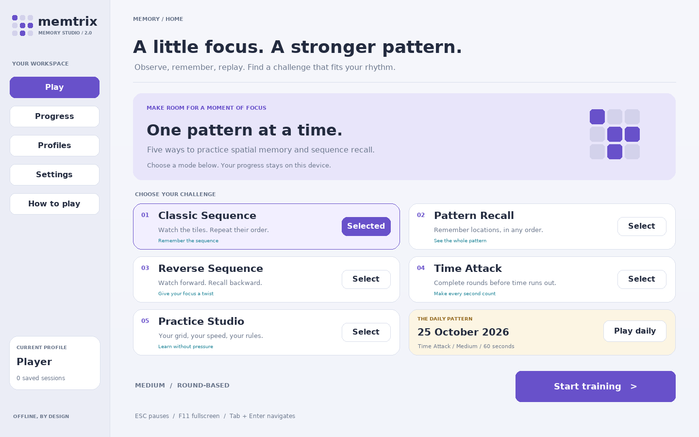
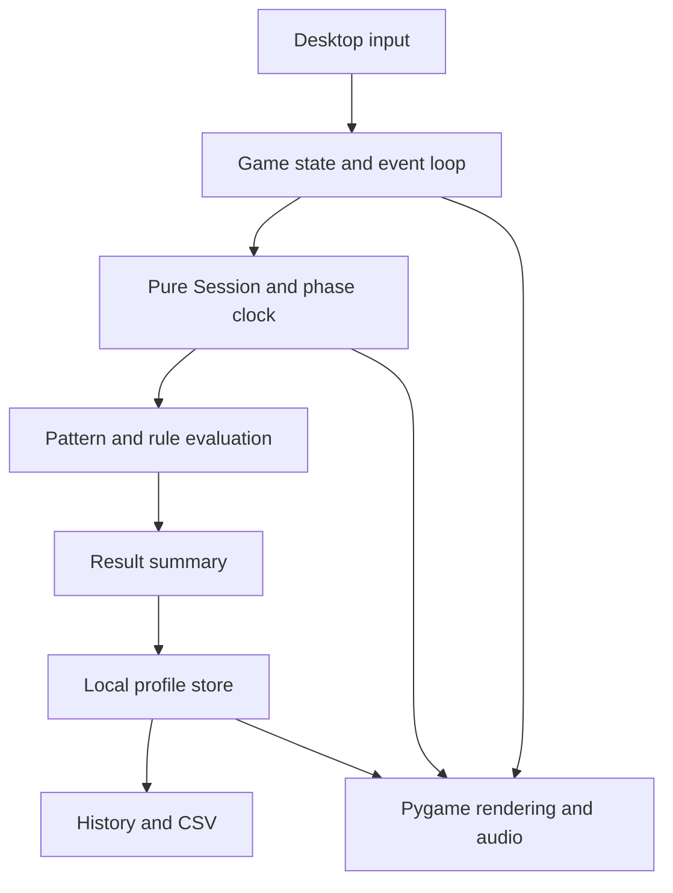

<div align="center">

# Memtrix 2.0

**A little focus. A stronger pattern.**

A complete offline Python memory game with five modes, a redesigned interface, local profiles, progress charts, achievements and a repeatable daily challenge.

**Python 3.11+ · Pygame Community Edition · Local JSON saves · No account, GPU or API key required**

[Quick start](#quick-start) · [Modes](#five-game-modes) · [v1 vs v2](#version-10-vs-20) · [Architecture](#architecture) · [Tests](#testing)

</div>



More screens: [Pattern Recall](docs/screenshots/pattern-preview.png) · [Settings](docs/screenshots/settings.png) · [Progress](docs/screenshots/history.png) · [Results](docs/screenshots/daily-results.png). Screens show local test sessions; their player save files are not bundled.

## What is Memtrix?

Memtrix is a native desktop game about observing and recalling tile patterns. Watch a sequence, reproduce it, remember a group of locations, or challenge yourself to enter the sequence backward. The game records results so you can inspect your own sessions over time.

Version 2.0 develops the supplied **Memory Matrix / Memtrix v1.0 coursework** into a structured application. It preserves the original source, score JSON and reports in clearly labeled archive folders. The current implementation stays Python-based: **Python is the core language**, Pygame handles input/graphics/audio, and local JSON holds profiles and progress.

The project is useful for a game-development presentation, studying state machines and event-driven programming, practicing spatial/sequence recall, and building a readable Python portfolio. It is an entertainment/training game, not a clinical memory assessment or evidence of a guaranteed improvement in general cognitive ability. No AI model, cloud service, web server or external game integration is included.

## Version 1.0 vs 2.0

| Area | Supplied v1.0 | Delivered v2.0 |
|---|---|---|
| Gameplay | One ordered tile-sequence game | Classic Sequence, Pattern Recall, Reverse Sequence, Time Attack and Practice Studio |
| Interface | Fixed 600 × 600 neon menu and board | Modern memory dashboard, mode cards, adaptive board, HUD, countdown, pause overlay and detailed results |
| Playback | Fixed five-second cutoff can truncate long patterns | Schedule derived from the whole sequence length; every tile gets its intended display time |
| Pause | Wall-clock deadlines can advance while paused | All playback, feedback, recall and session timers freeze |
| Input | All mouse buttons accepted; global delay rejects fast legitimate clicks | Left-button selection, event-position mapping, no arbitrary global debounce, duplicate selection handling |
| Feedback | A correct location in the wrong order may appear green | Each selection is checked against the actual rule immediately; incorrect selection is marked with an X |
| Progression | Configured max levels are not enforced | Competitive grid capped at 6 × 6 and sequence capped at 20 tiles |
| Display | Board can eventually exceed the window | Auto-sized board on a resizable, letterboxed 1440 × 900 logical canvas; F11 fullscreen |
| Timing | Mixed wall-clock updates and draw-time animation changes | Pure active-time phase model, with rendering separated from rule updates |
| Scores | Load/save helpers disconnected; mixed `Hard` / `hard` keys | Validated atomic persistence and case-normalized legacy import kept separate from v2 scores |
| Statistics | In-memory difficulty bests | Per-profile history, grouped personal bests, accuracy chart, achievements and CSV export |
| Settings | Difficulty constants in source | Difficulty, Time Attack duration, practice grid/length/style/speed, tile theme, sound and reduced motion |
| Audio | No feedback sound bank | Optional locally generated tones; silent fallback if audio cannot initialize |
| Reliability | Basic JSON loading | Type validation, bounded history, damaged-save recovery and write-error notices |
| Verification | No supplied automated suite | Automated model/storage/UI tests and an SDL event-dispatch smoke check |
| Distribution | Source and reports bundled with a virtual environment | Clean source ZIP, starter scripts, packaging metadata, CI and documentation |

**Classic preserves the original watch-and-repeat concept, not the exact old balance or scoring.** Version 2.0 has documented life limits, progression and points. The original reports describe v1.0 and remain unchanged; the README and current guides describe v2.0.

## Quick start

Use **Python 3.11 or newer** in a desktop session. Memtrix opens a native window, not a browser.

### Windows / PyCharm

Extract the entire ZIP. Open the folder containing `main.py` and run:

```powershell
py -3 -m venv .venv
.\.venv\Scripts\python.exe -m pip install -r requirements.txt
.\.venv\Scripts\python.exe main.py
```

If `py` is unavailable, use `python -m venv .venv` for the first command. In PyCharm, choose `.venv\Scripts\python.exe` as the interpreter and run the root `main.py`.

Alternatively, double-click **start_windows.bat**. It creates a local environment and installs the dependency when needed. Initial installation needs internet; installed gameplay works offline.

### Linux / macOS

```bash
python3 -m venv .venv
.venv/bin/python -m pip install -r requirements.txt
.venv/bin/python main.py
```

Or run `sh start_unix.sh`.

Pygame Community Edition is installed as `pygame-ce` but imported as `pygame`. Use a fresh virtual environment rather than installing both `pygame` and `pygame-ce` together. Visuals are drawn in code, fonts come from available system fonts, and feedback tones are synthesized locally; no separate asset downloads are required.

### Optional installed command

```bash
python -m pip install -e .
memtrix
```

`python -m memtrix` also launches the game from the project folder. The root launcher, module command and installed command all call the same application.

## Five game modes

| Mode | What you do | End condition / assistance |
|---|---|---|
| **Classic Sequence** | Watch individual tiles, then repeat them in the displayed order | Difficulty-based lives; a recall deadline per round |
| **Pattern Recall** | Observe all highlighted locations together, then select those locations in any order | Difficulty-based lives; no ordering requirement |
| **Reverse Sequence** | Watch the normal sequence, then enter it backward | Difficulty-based lives; wrong order is checked immediately |
| **Time Attack** | Complete as many sequence rounds as possible | 60 / 90 / 120 active seconds; mistakes do not exhaust lives |
| **Practice Studio** | Choose grid, length, playback speed and recall style | No recall/session time limit; replay hints; excluded from competitive bests |

Every run starts with a three-second countdown. Input is locked during playback and feedback. A short feedback phase reveals the expected locations/order before the next round. Wrong selections end the current round immediately; no points are awarded for a partially recalled round.

### Difficulty and progression

| Difficulty | Initial grid | Initial length | Lives | Flash / gap | Base recall allowance |
|---|---|---:|---:|---|---:|
| Easy | 3 × 3 | 3 | 3 | 0.80 / 0.24 s | 18 s |
| Medium | 4 × 4 | 4 | 2 | 0.60 / 0.20 s | 14 s |
| Hard | 5 × 5 | 5 | 1 | 0.42 / 0.16 s | 10 s |

In competitive modes, each successful round adds a tile, capped at **20**. Every three successful rounds increases the grid dimension by one, capped at **6 × 6**. Patterns contain distinct tile locations and never request more tiles than the grid holds. At the cap, play continues with new patterns without enlarging the board further.

Recall time allowance is `base allowance + 1.2 × sequence length`. It starts **after playback ends**. A wrong selection or recall timeout removes one life in Classic, Pattern and Reverse. Time Attack uses the recall deadline too, but its overall timer is the end condition and counts playback, recall and feedback. Practice has no recall deadline.

### Pattern playback

Sequence modes use a 0.4-second lead-in, the full sequence of flashes/gaps, then a 0.3-second tail. Playback length is calculated from the sequence, rather than cut off at five seconds.

Pattern Recall shows all target locations simultaneously for `1.5 + 0.3 × length` seconds, between the lead-in and tail. Tiles are blank before recall input begins. Reverse shows the original forward sequence and expects its reverse during input.

## Controls

| Input | Action |
|---|---|
| Left click | Select a menu control or recall tile |
| Tab / Shift+Tab | Move focus among visible controls, including board tiles |
| Enter / Space | Activate the focused control |
| ESC during play / pause | Pause / resume |
| ESC in a workspace screen | Return to Play |
| ESC during countdown | Cancel the unfinished run |
| Enter after countdown focus loss | Start the countdown again |
| H during Practice recall | Replay the same pattern as a hint |
| F11 | Toggle fullscreen and return to the previous window size |
| R on results | Restart the same mode |
| Pause → End session & save | End Practice or save another run early |
| Close window / How to play → Quit application | Exit |

Right clicks, off-board clicks and clicks during playback/feedback are ignored. Selecting the same tile twice in one recall attempt is ignored rather than counted as a new mistake. Distinct rapid clicks have no global 200 ms rejection period. Letterbox margins are excluded from input coordinates.

Focus loss pauses a playing run automatically. Pause freezes active session time, pattern playback, recall deadlines and feedback time. Closing the application or restarting a still-unfinished attempt discards that attempt; use End session & save when you want it retained.

## Scoring and results

Only successfully completed rounds earn points:

```text
base points   = 100 × number of tiles
speed bonus   = round(100 × max(0, 1 − recall seconds / recall allowance))
streak bonus  = 25 × min(8, consecutive successful rounds − 1)
round points  = base points + speed bonus + streak bonus
```

Practice has no recall allowance, so its speed bonus is zero. A mistake or timeout resets the streak. Scores are prioritization/game feedback, not a standardized cognitive measurement.

Results record score, rounds completed/failed, selection accuracy, longest recalled pattern, mistakes, timeouts, best streak, average successful-round recall time, active elapsed time, hints and assistance state.

- **Selection accuracy** is correct accepted selections / all accepted selections. Ignored duplicates and invalid/out-of-phase clicks do not count. A timeout counts as a failed round, not as a fabricated incorrect tile selection; inspect timeout and round counts alongside accuracy.
- **Average recall time** measures the full successful response after its most recent preview. It includes thinking and input time and is not a clinical memory or reaction-time assessment.
- **Personal bests** compare naturally completed, unassisted positive-score runs within the same mode, difficulty and configured duration. Manually ended runs, zero scores and all Practice runs remain in history but are excluded from those tables.
- Theme, audio and motion choices do not alter competitive game rules. Practice gameplay choices do not change competitive playback.

## Daily challenge

The Daily card launches **Time Attack / Medium / 60 seconds**, with a seed derived from the computer's local date and the v2 game identifier. The challenge date and seed are stored with the result. Personal bests use a separate challenge-date group.

The seed makes the pattern stream repeatable for equivalent game progress and the same version; the actual time a player reaches a pattern depends on their responses. Personal display/audio preferences remain usable. This is an offline challenge with no server clock, account, anti-cheat or global leaderboard.

## Profiles, progress and achievements

- Create up to **20 local profiles**, each with separate settings, sessions and imported legacy scores.
- Names contain 1–24 readable characters and are case-insensitively unique when created.
- Each profile retains up to **1,000 recent saved sessions**.
- Progress contains filtered/paginated history, a last-12-filtered-runs selection-accuracy chart, personal bests, seven achievements and a Legacy v1 tab.
- Achievements reward a first completed round, a seven-tile pattern, accuracy over at least 30 selections, five Reverse rounds, completing a daily run with at least one cleared round, a five-round streak and ten saved sessions. Achievements can use saved practice evidence; competitive bests remain unassisted-only.
- **Export CSV** exports the active profile's retained v2 history, including mode, difficulty, assistance/hint status, metrics, seed, date and version. It uses UTF-8 BOM and spreadsheet-formula protection.

Profiles organize local progress; they are not password-protected accounts. Files are neither encrypted nor signed. Anyone with access to the data folder can inspect/edit them.

## Settings

Settings save automatically for the active profile. Click a value, or focus it and press Enter, to cycle choices.

| Setting | Choices / scope |
|---|---|
| Difficulty | Easy / Medium / Hard |
| Time Attack duration | 60 / 90 / 120 seconds |
| Practice grid | 3 / 4 / 5 / 6 / 8 tiles per side |
| Practice sequence length | 3 / 4 / 6 / 8 / 12, clamped to board capacity |
| Practice playback | Slow / Normal / Fast; sequence flash duration 1.00 / 0.65 / 0.35 s |
| Practice recall style | Sequence / Pattern / Reverse |
| Tile theme | Iris / Ocean / Amber / High contrast |
| Sound volume | 0 / 25 / 50 / 75 / 100% |
| Reduced motion | Stops decorative dashboard cycling; essential tile flashes remain |
| Frame cap | 60 / 120 / 144 rendered frames per second |

Menus support keyboard navigation and feedback includes numbers/dots/X as well as color. The High contrast setting provides a distinct tile palette. This Pygame application does not claim screen-reader accessibility certification.

## Saved data and recovery

The game saves outside the source directory so upgrading the source folder does not overwrite progress.

| Platform | Default data folder |
|---|---|
| Windows | `%LOCALAPPDATA%\Memtrix` |
| Linux | `$XDG_DATA_HOME/memtrix`, or `~/.local/share/memtrix` |
| macOS | `~/.local/share/memtrix` by default; XDG override is supported |

The exact path appears under How to play. `progress.json` holds all profiles. CSVs go in `exports/`. Damaged save recovery copies use `progress-recovery-<id>.json`.

Choose another location with:

```bash
python main.py --data-dir ./my-memory-data
```

`MEMTRIX_DATA` is also supported; the command-line path takes precedence. Use one application instance per data directory. Back up that folder while the game is closed.

Writes use a temporary file, flush/fsync and atomic replacement. Unknown/damaged top-level formats are preserved as recovery copies and a fresh profile is supplied. Invalid individual session rows are skipped. Save failure produces a notice and keeps in-memory progress for the current visit; persistence across restart requires a writable folder.

## Import v1 high scores

The supplied old score file contains case-inconsistent difficulty names. Import normalizes them and keeps the highest valid nonnegative integer per recognized difficulty.

In the source ZIP, open **Progress → Legacy v1 → Import archived v1 scores** to import the preserved original JSON into the active profile. It is an explicit action, not prefilled v2 progress.

For a different original score file:

```bash
python main.py --import-v1 /path/to/highscores.json
```

Use a quoted path if it contains spaces. The import never creates v2 sessions or merges the old values into v2 personal bests, because scoring/rules differ. Legacy imports are kept per profile, persist across restarts, and repeated imports never lower an existing legacy value.

## Architecture



One event loop coordinates Play, Countdown, Playing, Paused, Results, Profiles, Settings, Progress and Help. The Session independently owns Preview, Recall and Feedback phases. Only the Playing screen advances Session time. Large time updates consume phase boundaries in order rather than skipping necessary rule transitions.

| Module | Responsibility |
|---|---|
| `model.py` | Pure Python patterns, playback schedules, timers, scoring, progression, daily seeds and achievements |
| `app.py` | Screen lifecycle, event dispatch, scaled input, board layout and result persistence |
| `ui.py` | Drawing helpers, button focus/hover, text/font caches and common palette |
| `audio.py` | Generated optional sound bank and nonfatal audio fallback |
| `storage.py` | Validated bounded profiles/history, atomic saves, CSV and separate legacy imports |

The simulation model imports no Pygame, window or filesystem code. Rendering never changes rule state or tile ages. Gameplay timing uses passed active elapsed time, rather than wall-clock deadlines that continue during pause.

The game renders a **1440 × 900 logical canvas**, scales it with preserved aspect ratio, and maps mouse-event positions through the same viewport. Board geometry is cached by grid size; even an 8 × 8 Practice board remains within its play area. Actual visible/input responsiveness still depends on the desktop, display and frame rate.

## Performance work

- The gradient background is built once instead of drawing hundreds of gradient lines every frame.
- Common fonts and repeated text are cached, with a bounded 768-entry rendered-text cache.
- Tile rectangles are cached by grid dimension, and tiles are drawn directly rather than allocating one image surface per tile per frame.
- Sequence generation uses sampling without replacement; grid/length limits prevent runaway board growth.
- Only visible history rows are drawn; retained sessions are bounded per profile.
- Sound samples are generated once and playback remains optional.

The smoke check measures median/p95 CPU update/render calls in its documented environment. See [validation](docs/VALIDATION.md). These are scoped headless renderer measurements, not physical-display FPS, input latency or a claimed percentage improvement over v1.0.

## Project layout

```text
Memtrix-2.0/
├── main.py                       # Familiar launcher
├── memtrix/
│   ├── __init__.py                # Version
│   ├── __main__.py                # python -m memtrix
│   ├── app.py                     # Input, screens and application lifecycle
│   ├── model.py                   # Pure rules, phases, patterns and scoring
│   ├── ui.py                      # Painter, buttons, fonts and themes
│   ├── audio.py                   # Generated optional tones
│   └── storage.py                 # Profiles, recovery, CSV and v1 import
├── tests/                        # Rules, timing, data and SDL UI regression tests
├── tools/smoke_check.py           # End-to-end event/rendering exercise
├── docs/
│   ├── ARCHITECTURE.md
│   ├── HOW_TO_PLAY.md
│   ├── VALIDATION.md
│   ├── screenshots/              # Actual v2.0 rendered screens
│   └── original_v1.0/            # Original submission PDF and play guide
├── legacy/v1.0/                  # Five original Python modules and score JSON
├── .github/workflows/tests.yml
├── requirements.txt
├── requirements-dev.txt
├── pyproject.toml
├── start_windows.bat
├── start_unix.sh
├── START_HERE.md
└── CHANGELOG.md
```

## Testing

```bash
python -m pip install -r requirements-dev.txt
python -m pytest -q
python tools/smoke_check.py
```

The automated suite covers mode rules, correct/reverse/unordered recall, long playback, timing across update rates, life limits, progression caps, scoring, hints, pause/focus, resized click positions, profiles, corruption recovery, write failures, CSV and v1 imports.

The smoke check uses real posted Pygame events and temporary profile data with SDL dummy drivers by default. It solves rounds in all five modes, replays a hint, freezes/resumes phases, restarts, completes a daily run, imports the archived scores, exports CSV and exercises the public run loop with a queued quit. It does not touch normal player saves.

```bash
python tools/smoke_check.py --screenshots ./qa-screens --report ./qa-result.json
```

The GitHub workflow is configured for Windows/Linux and Python 3.11–3.13. Actual CI results must be observed after pushing the repository; the configured matrix is not a claim of completed native testing. The delivery's executed checks and environment limits appear in [VALIDATION.md](docs/VALIDATION.md).

## Troubleshooting

| Problem | Action |
|---|---|
| `No module named pygame` | Install requirements with the same virtual-environment Python used to run `main.py`. |
| Conflicting Pygame packages | Use a fresh environment and install only `requirements.txt`; pygame-ce supplies the `pygame` module. |
| No window/display | Run in a desktop session. Dummy SDL drivers are for tests and do not provide a visible interactive game. |
| No sound | Check volume/device or run `python main.py --no-audio`; gameplay works without audio. |
| Tile clicks appear offset | Run the new root launcher; let it handle scaling. Black margins are not part of the board. |
| Click ignored | Wait for Recall, use the left button and choose an unselected tile; repeated/inactive-phase selections are intentionally ignored. |
| Long pattern takes more than five seconds | Expected: v2 displays the entire sequence instead of truncating it. |
| Low frame rate | Use a smaller window, a 60 FPS cap and reduced motion; close heavy background applications. |
| Progress does not persist | Check the in-game notice and save-folder permissions; try a writable `--data-dir`. |
| Save damaged | The game preserves a recovery copy. Restore a known-good backup with the game closed if needed. |
| Imported high scores missing from bests | They belong in Legacy v1; original scores intentionally do not enter v2 best tables. |
| Previously saved history reappears after extraction | Progress lives outside the source folder intentionally. Use a new `--data-dir` for a clean demo. |

## Publishing and presenting

Run tests before uploading. Keep environments, personal progress, temporary QA files and recovery/export data out of commits. The included `.gitignore` covers common generated files. The archived coursework reports contain submission identity details; decide whether to publish those documents with the repository.

For a presentation, demonstrate the full sequence, an immediate wrong-order response, pause during playback, an 8 × 8 Practice board, an assisted replay, and a saved result. Explain the different order rules and show that v1 imports are separated. Current docs describe v2; archived v1 reports should be identified as the original submission.

The game has no online accounts, multiplayer, cloud sync, anti-cheat, packaged Windows executable or clinical assessment claim. The source ZIP runs through Python; physical Windows/macOS playtesting is still needed on the intended demonstration machine.

## Authorship and dependencies

Original coursework: **MONIKA AKTER**, student ID **202380090145**, as identified by the supplied submission. The five original source modules, original score JSON and both original PDFs are preserved byte for byte in the archive folders.

Pygame Community Edition and Python retain their respective upstream licenses. No external art pack, commercial font, music track or AI service is bundled. The author can select the project-source license when publishing.
