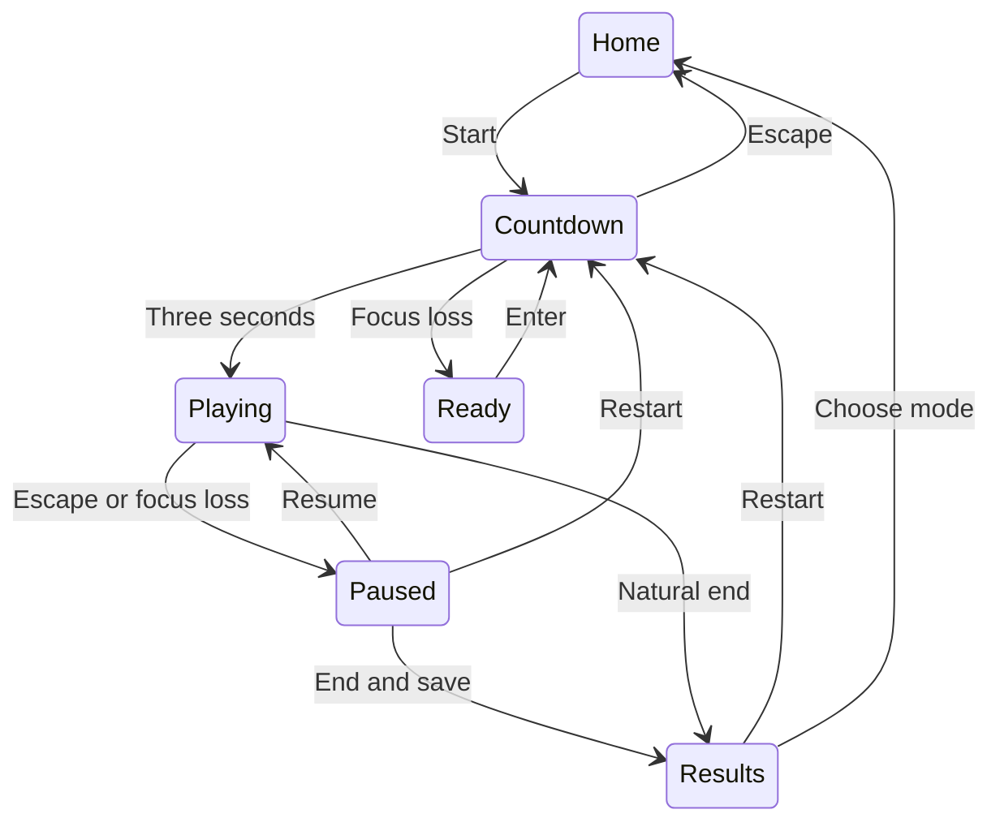

# Memtrix 2.0 architecture

The root launcher calls `memtrix.app.main()`. Importing the model or package does not open a window. Game coordinates display, events, Store, Audio and Painter. Session owns the rules and active phase clock.

| Module | Boundary |
|---|---|
| `model.py` | Pure Python; patterns, ordering, phase timing, score, progression, assistance and achievement evidence |
| `app.py` | One SDL event loop, menu/run states, scaled input, display and result-saving coordination |
| `ui.py` | Cached fonts/text/background, drawing and focusable controls |
| `audio.py` | Optional generated tones; initialization failure is nonfatal |
| `storage.py` | Validated profiles/history, atomic writes, bounded retention, separate legacy records and CSV |

## State separation

Inside Playing, Session cycles Preview → Recall → Feedback → Preview. Only Playing calls `Session.update(dt)`. Pausing leaves every Session clock unchanged. A large update consumes its remainder across phase boundaries in order and clips exactly to Time Attack's end. Rendering never advances tile/pattern state.

Preview length is derived from pattern length and flash/gap settings. There is no arbitrary five-second transition. All generated locations are distinct. Competitive grid size is bounded at six and pattern length at 20; practice supports at most an eight-by-eight board and clamps its pattern to capacity.

## Recall and scoring

Classic/Time Attack expect the generated order; Reverse expects its reverse; Pattern Recall accepts unique members in any order. Input during Preview/Feedback, right clicks, duplicate tiles and out-of-board coordinates are ignored. Every accepted selection has an immediate correct/incorrect rule result. A completed round earns base points and bounded speed/streak bonuses. Errors/timeouts affect lives where applicable, then show the expected answer during Feedback.

All Practice is marked assisted and unranked, including runs without hints. A hint repeats the same pattern, resets that round's selected tiles and restarts preview. It does not generate another pattern or erase accepted-selection metrics already recorded.

## Display and input

Painter draws to a 1440 × 900 logical canvas. Game preserves aspect ratio during resize/fullscreen and maps mouse-event positions through the same letterbox viewport. Grid rectangles are cached per dimension in a fixed board zone. Menus and grid tiles share the same focusable-control mechanism for Tab/Enter input. Duplicate input is handled by the model rather than global wall-clock debouncing.

## Persistence

Schema 2 stores active profile and a profiles object. Each profile owns validated settings, up to 1,000 recent v2 session rows and separate legacy score values. New rows include a UUID, UTC completion timestamp, game version, seed and challenge date.

Temporary JSON writes happen beside the final file, followed by flush/fsync and `os.replace`. Invalid top-level data is copied to a recovery file; malformed individual session rows are skipped. Write failures retain the process's in-memory state and show a notice. Concurrent instances sharing one directory are unsupported.

V1 imports normalize difficulty capitalization, validate nonnegative integer scores and retain maximum existing values. They never manufacture v2 session rows. Profiles are local organizational units, not authentication; files are editable and not encrypted/signed.

## Maintenance

Add/change mode rules in the pure model first, then test playback, order, timing, progression and assistance boundaries. Update personal-best grouping when adding gameplay settings that affect comparability. Version or migrate save meanings when changing record schemas. Keep original coursework archived rather than mixing old modules into the new launcher.

Native hardware/display/audio tests complement the headless SDL checks. The supplied CI matrix is configuration, not proof that every platform has already been executed.
